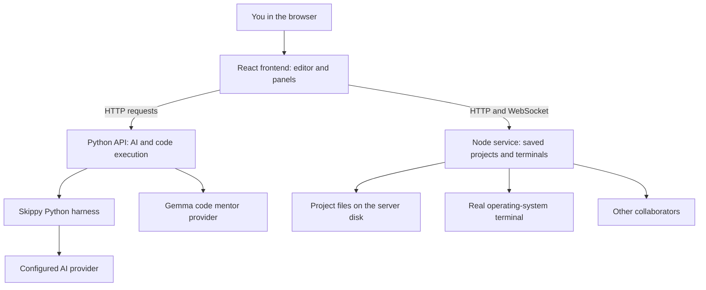

# Skippy IDE: an easy guide to the code

This guide explains what the project does, where its code lives, and how its main parts communicate. You do not need to understand every file before using it. Start with sections 1–4, then read the feature you want to understand.

## 1. What are we building?

Skippy is a browser-based coding workspace. You can write code, save projects, run programs, use a real terminal, work with another person, and ask an AI assistant for help.

There are two different kinds of files to keep in mind:

- **Application code:** the code in this repository that builds the IDE itself.
- **Workspace code:** the Python, C, Java, or other files you create inside the IDE. Saved workspace files live in the IDE server's project storage.

Changing `EditorView.tsx` changes the IDE interface. Changing `main.py` inside a saved project changes the program you are working on.

## 2. The three main parts

| Part | Simple explanation | Location | Default local port |
|---|---|---|---|
| Frontend | The screen you see and click in your browser | `skippy_paradox/frontend/` | `3100` |
| Python API | Receives requests for AI help, mentoring, and code execution | `skippy_paradox/backend/` | `8100` |
| Node workspace service | Stores projects, manages real terminals, and synchronizes collaborators | `skippy_paradox/backend-socket/` | `4100` |

The **Skippy harness** is the Python coding-agent engine used by the AI integration and terminal CLI. It lives in `Skippy_harness/`.



**HTTP** is a request followed by a response. For example, the browser asks the server to save a project. **WebSocket** keeps a connection open so terminal output and collaboration updates can arrive immediately.

## 3. Technology stack, in plain language

| Technology | What it does here |
|---|---|
| React | Builds the interface from reusable pieces called components |
| TypeScript | Adds type checks to frontend JavaScript, helping catch mistakes before running |
| Vite | Starts the frontend development server and creates the production build |
| Tailwind CSS and regular CSS | Style panels, buttons, spacing, themes, and mobile layouts |
| Monaco Editor | The actual code editor, including highlighting, cursor handling, and language editing features |
| `react-resizable-panels` | Lets users drag dividers to resize the editor and side panels |
| Lucide icons | Supplies the interface's small icons |
| xterm.js | Displays the terminal inside the browser |
| Node.js | Runs the workspace and collaboration server |
| `node-pty` | Starts a real shell process and connects it to the browser terminal; uses ConPTY on Windows |
| `ws` | Handles WebSocket connections on the Node server |
| Yjs and `y-monaco` | Keep shared editor text synchronized when several people edit |
| Python | Runs the API, coding harness, and Python execution path |
| FastAPI | Defines API routes and validates incoming requests |
| Uvicorn | Runs the FastAPI application |
| HTTPX | Makes outgoing requests to external services from Python |
| OpenAI Python SDK | Provides an API client for supported model providers; using this library does not mean every request goes to OpenAI |
| Ollama | Runs supported AI models on the host machine when configured |
| OpenRouter / Gemini provider integrations | Connect the app to configured hosted model services |
| Rich and prompt-toolkit | Make the Python terminal assistant readable and interactive |
| Playwright, Node tests, Python unittest | Check browser interactions, service behavior, and harness logic |

The exact dependency lists are in the frontend and socket `package.json` files, the backend `requirements.txt`, and the harness `pyproject.toml`.

## 4. Folder map

```text
Hacktober_AOT/
|-- README.md                 Existing general project documentation
|-- README_CODE_GUIDE.md      This easy-language code guide
|-- package.json              Root commands for starting, building, and testing
|-- requirements.txt          Installs backend dependencies and the Python harness
|-- setup.ps1                 Windows setup helper
|-- scripts/                  Launch and serving helpers
|-- skippy_paradox/
|   |-- frontend/             Browser interface
|   |   |-- src/components/   Visible UI pieces
|   |   |-- src/hooks/        Reusable state and behavior
|   |   |-- src/services/     Communication and storage helpers
|   |   |-- src/utils/        Small reusable helpers
|   |   `-- public/           Static assets and browser app resources
|   |-- backend/              Python API
|   |   `-- routers/          API endpoints grouped by feature
|   `-- backend-socket/       Projects, collaboration, and real terminal server
|-- Skippy_harness/
|   |-- skippy_harness/       Python coding-agent implementation
|   `-- tests/                Tests for the harness
|-- tests/                    App-level integration and browser tests
|-- deployment/               Deployment support files
|-- artifacts/                Saved screenshots and verification outputs
|-- .skippy-ide/              Saved projects and checkpoints, created at runtime
|-- .venv310/                 Python environment used by the local launcher by default
`-- node_modules/             Installed JavaScript packages, including nested service copies
```

The main folders you edit are `frontend/src/`, `backend/`, `backend-socket/`, and `Skippy_harness/skippy_harness/`. Installed dependencies and generated build output are not where you implement application features.

## 5. Important frontend files

| File | Its job |
|---|---|
| [`src/index.tsx`](skippy_paradox/frontend/src/index.tsx) | Starts React in the page and configures editor loading |
| [`src/App.tsx`](skippy_paradox/frontend/src/App.tsx) | Connects files, project state, collaboration, and the main view |
| [`EditorView.tsx`](skippy_paradox/frontend/src/components/EditorView.tsx) | Arranges the workspace: header, tabs, editor, panels, Run action, and shortcuts |
| [`WorkspaceWelcome.tsx`](skippy_paradox/frontend/src/components/WorkspaceWelcome.tsx) | Shows the starting screen when no file is open |
| [`FileExplorer.tsx`](skippy_paradox/frontend/src/components/FileExplorer.tsx) | Displays files and folders and lets you choose a file |
| [`MonacoSurface.tsx`](skippy_paradox/frontend/src/components/MonacoSurface.tsx) | Shared editor surface used by the editor components |
| [`ModernMonacoEditor.tsx`](skippy_paradox/frontend/src/components/ModernMonacoEditor.tsx) | Handles ordinary local editing |
| [`CollabMonacoEditor.tsx`](skippy_paradox/frontend/src/components/CollabMonacoEditor.tsx) | Connects the editor to shared collaborative text |
| [`CodeRunner.tsx`](skippy_paradox/frontend/src/components/CodeRunner.tsx) | Shows execution output, errors, language choice, and standard input |
| [`TerminalPanel.tsx`](skippy_paradox/frontend/src/components/TerminalPanel.tsx) | Displays and controls the real workspace shell |
| [`WorkspaceBar.tsx`](skippy_paradox/frontend/src/components/WorkspaceBar.tsx) | Saves/opens projects and provides checkpoint review controls |
| [`CheckpointDiff.tsx`](skippy_paradox/frontend/src/components/CheckpointDiff.tsx) | Shows differences between a checkpoint and current files |
| [`HarnessPanel.tsx`](skippy_paradox/frontend/src/components/HarnessPanel.tsx) | Sends coding requests and displays agent activity, tool results, and approvals |
| [`GemmaPanel.tsx`](skippy_paradox/frontend/src/components/GemmaPanel.tsx) | Provides the AI workspace/mentor interface used by the current layout |
| [`CommandPalette.tsx`](skippy_paradox/frontend/src/components/CommandPalette.tsx) | Searchable commands and quick file picking |
| `ChatPanel.tsx`, `VoiceLobbyPanel.tsx` | Collaboration chat and voice interface |
| [`src/index.css`](skippy_paradox/frontend/src/index.css) | Main visual styling, theme tokens, and responsive rules |

Three useful frontend folder names:

- **Components** answer “What is shown on the screen?”
- **Hooks** answer “What state and behavior does this feature need?” For example, `useWorkspace.ts` manages the saved project and synchronization.
- **Services** answer “How do we talk to the backend or store data?” For example, `workspaceService.ts` wraps project requests and `harnessService.ts` reads agent events.

Some files come from earlier UI versions. A file's existence does not mean it is active. Follow imports from `App.tsx` and `EditorView.tsx` to see what the current screen actually uses.

## 6. Important server files

| File | Its job |
|---|---|
| [`backend/main.py`](skippy_paradox/backend/main.py) | Creates the FastAPI application and registers feature routes |
| [`routers/judge0.py`](skippy_paradox/backend/routers/judge0.py) | Handles Run-button execution and compiler/interpreter responses |
| [`routers/harness.py`](skippy_paradox/backend/routers/harness.py) | Starts isolated agent workers, streams their events, and handles approval/cancellation |
| [`routers/gemma.py`](skippy_paradox/backend/routers/gemma.py) | Handles mentor requests, model/provider configuration, code context, and supported images |
| [`backend-socket/server.js`](skippy_paradox/backend-socket/server.js) | Starts the Node server and handles room/document connections |
| [`backend-socket/workspaces.js`](skippy_paradox/backend-socket/workspaces.js) | Stores projects, validates paths, detects save conflicts, and manages checkpoints |
| [`backend-socket/ide-service.js`](skippy_paradox/backend-socket/ide-service.js) | Provides project APIs, terminal sessions, input ownership, and agent coordination |

## 7. Where does my code get saved?

Browser storage can remember editor files and preferences. A **saved project** also has real files on the server disk.

Default saved-project layout:

```text
.skippy-ide/
`-- <project-id>/
    |-- project.json          Project name and settings
    |-- files/                Actual code used by the terminal
    `-- ...                   Checkpoint and project support data
```

`SKIPPY_WORKSPACE_ROOT` can change the storage location. Opening the terminal starts the shell in that project's `files/` directory.

An editor save checks the previous file contents before replacing the disk version. If the terminal or another participant changed the same file, the IDE can report a conflict instead of silently overwriting it.

**Import folder copies supported files into a saved workspace.** The saved workspace is not a live connection to the original folder. Large, binary, dependency, and generated files can be skipped from editor import/listing. Files created by the terminal can still exist on disk even when they do not appear as editable text in the explorer.

A **checkpoint** is a saved project snapshot you can compare with or restore later. It is useful before an AI run. Restoring requires stopping the agent and closing terminal sessions; a recovery checkpoint preserves the state before restoration.

## 8. Run button versus Terminal

These are different features.

| Run / Output | Terminal |
|---|---|
| Sends the active file's code to the execution API | Starts a real shell in the saved project's folder |
| Shows one execution result | Supports repeated commands and interactive programs |
| Optional input is supplied through the runner's input field | You type input directly while the program is running |
| Useful for a small standalone snippet | Useful for several files, dependencies, builds, and project commands |
| Does not automatically run the whole saved project | Works directly with saved project files |

For the Run button, the flow is `EditorView -> CodeRunner -> judge0Service -> /api/judge0/execute -> compiler/interpreter result -> Output`.

The runner contains external execution integrations and local execution paths for Python, JavaScript, C, C++, and Java. A displayed language option is not proof that its runtime is installed or its external service is configured.

The terminal flow is `TerminalPanel -> WebSocket -> ide-service.js -> node-pty -> operating-system shell`.

### Example commands in the Windows workspace terminal

Save/open a project first, open **Terminal**, and use the filename that actually exists in your project:

```powershell
# Python: the Windows launcher can work even when the python alias does not
py -3 main.py

# C: compile first, then run the executable if compilation succeeds
gcc main.c -o c_program.exe
.\c_program.exe

# C++
g++ main.cpp -o cpp_program.exe
.\cpp_program.exe

# Java: class Main should be in Main.java
javac Main.java
java Main
```

**The program runs on the computer hosting the IDE's backend.** If the server runs on your laptop, it can use that laptop's installed runtimes. If the website is deployed on another server, installing Python on your laptop does not install Python on that server. A browser page cannot automatically use your laptop's terminal.

On Windows, `python` can resolve to the Microsoft Store shortcut even when `py -3` works. Check the actual command rather than assuming both names use the same installation.

## 9. What is the Skippy harness?

A **model** generates text and tool requests. A **harness** is the application code around the model that gives it context, executes permitted tools, sends back results, and manages the conversation.

| Python file | Simple responsibility |
|---|---|
| `agent.py` | Starts and runs the interactive terminal assistant |
| `config.py`, `models.py` | Provider configuration, model selection, and model discovery |
| `llm.py` | Model requests, message conversion, and agent/model interaction |
| `tools.py` | Defines callable tools, validates arguments, and dispatches them |
| `permissions.py` | Decides whether an action is allowed, denied, or needs approval |
| `sandbox.py` | Shell execution rules and execution behavior |
| `web_worker.py` | Runs the agent for a browser request and emits structured events |
| `ide_launcher.py` | Connects terminal Skippy to the IDE's project/room agent lock |
| `session.py`, `history.py` | Saves conversation state and manages tool-output history |
| `compact.py`, `context.py` | Keeps conversation context manageable |
| `todos.py` | Tracks the agent's multi-step plan |
| `skills.py` | Loads extra instructions from available skill files |
| `subagent.py` | Supports bounded exploration tasks in the CLI harness |
| `commands.py`, `ui.py` | Terminal commands and interactive presentation |

Typing `skippy` in the IDE terminal starts the Python assistant in that saved workspace. `skippy --resume` resumes a saved session. Commands such as `/model` and `/provider` change the terminal assistant's configuration.

The browser coding agent uses a per-run workspace copy through `web_worker.py`. Changed file events are checked and applied back to editor/project state. Terminal Skippy works directly in the saved project's directory. Both paths coordinate with the workspace agent lock so two agent runs do not edit the same project simultaneously.

## 10. Tool calling, step by step

Suppose you ask: “Read main.py, fix the calculation, and explain the change.”

1. The harness sends your request, relevant context, and the available tool descriptions to the model.
2. The model requests `read_file` with a path argument.
3. The harness validates the tool name and arguments and checks permission.
4. Application code reads the file and returns its actual contents.
5. The model uses that result and requests `str_replace` or `write_file`.
6. The harness checks and performs the edit, then returns success or an error.
7. The model continues until it can answer or reaches a run limit/error.

An example tool request, simplified:

```json
{
  "name": "read_file",
  "arguments": {
    "path": "main.py"
  }
}
```

The model writes the request; **your application executes it**. A statement such as “I edited the file” is not the same as a successful tool result.

| Tool | Easy explanation |
|---|---|
| `read_file` | Read an existing text file |
| `write_file` | Create a file or replace its contents |
| `str_replace` | Replace exact text; normally requires one matching location |
| `write_todos` | Create/update a plan for a multi-step task |
| `list_files` | List editable files in the browser agent's workspace |
| `bash` | Run a shell command; the name remains `bash`, but Windows execution uses PowerShell |
| `read_skill` | Read supporting instructions in the CLI harness |
| `task` | Delegate bounded exploration in the CLI harness |

The available tools differ by entry point. The browser worker exposes file tools, todos, and `list_files`; shell is added only when `SKIPPY_ALLOW_SHELL=true`. Its current allowed set does not expose CLI `task` or `read_skill` tools.

The browser receives newline-separated JSON events such as tool progress, file changes, approvals, errors, and completion. `harnessService.ts` reads the stream, and `HarnessPanel.tsx` updates the interface.

Invalid JSON, missing arguments, unknown tools, permission denials, and failed commands should return explicit errors. The harness should not treat an attempted action as a completed action.

## 11. Coding agent versus Gemma mentor

| Coding agent | Gemma mentor |
|---|---|
| Uses file tools to carry out coding tasks | Explains, reviews, diagnoses, and plans from supplied context |
| Can produce file-change events | Returns mentoring text through the mentor endpoint |
| Can request shell execution when enabled | Its mentor endpoint is not the file-editing tool loop |
| Uses the harness worker and agent coordination | Uses `gemmaService.ts` and `routers/gemma.py` |

The mentor supports modes such as **explain**, **review**, **debug**, and **plan**. Supported images can provide screenshot context. Provider choices depend on configured server credentials and available models. Selecting a model name alone does not make the provider ready.

## 12. How collaboration works

The host creates a room and approves participants. WebSockets carry room messages, chat, and control events. Yjs carries shared document updates so participants can edit together without sending the entire file after every keystroke.

**Terminal viewing and terminal input ownership are separate.** Several people can view output, but one person owns input at a time. Release/claim controls manage who can type.

Saved projects and checkpoints live on disk. Live rooms and terminal processes are runtime state; restarting services does not preserve them in the same way as saved project files.

## 13. Starting, building, and checking the app

Run these from the project root:

```powershell
# Develop the frontend with automatic refresh
npm.cmd run dev

# Check TypeScript and build the frontend
npm.cmd run typecheck
npm.cmd run build

# Serve the built frontend and start the supporting services
npm.cmd start
```

Open `http://localhost:3100`. The root launcher starts the Python API and Node workspace service too. `npm start` serves the built frontend, so source edits need another build; development mode updates the frontend while you work.

Common checks:

```powershell
npm.cmd run test:collab
npm.cmd run test:workspaces
npm.cmd run test:workspace-browser
npm.cmd run test:gemma-browser
.\.venv310\Scripts\python.exe -m unittest discover -s tests -p test_bridge.py -v
```

Some tests require a running service or a configured test environment. For example, `test:collab` uses port `4100` by default or `COLLAB_TEST_URL`. Test success for a mocked model verifies integration behavior, not the quality or availability of a real hosted model.

## 14. Configuration and important points

Use `.env.example` files as configuration references. Actual provider keys belong in server configuration, not in this guide or public source code.

| Setting | What it controls |
|---|---|
| `SKIPPY_PYTHON` | Python interpreter used by the local launcher/terminal harness |
| `SKIPPY_WORKSPACE_ROOT` | Saved-project storage location |
| `SKIPPY_ACCESS_TOKEN` | Access token for protected/remote workspace and API use |
| `SKIPPY_ALLOW_SHELL` | Whether the browser coding agent may request shell execution |
| `OLLAMA_BASE_URL`, `OLLAMA_MODEL` | Local model service address and model configuration |
| `OPENROUTER_API_KEY`, `GEMINI_API_KEY` | Hosted provider credentials |
| `MAX_AGENT_STEPS`, `LLM_TIMEOUT` | Agent-loop limit and model-request timeout |
| `VITE_API_URL` | Optional frontend API destination, included when building the frontend |

Important behavior to remember:

- Save or open a project before using terminal Skippy or the saved-workspace agent flow.
- The editor, Output runner, terminal, coding agent, and mentor are connected features with different execution paths.
- Compile C, C++, and Java before running their output. Dependencies must exist on the execution host.
- Shell commands and local code execution run with host-process permissions. The current local runner is not a container that makes arbitrary code harmless.
- Enable browser-agent shell access only intentionally; its permission/approval flow still matters.
- The current AI panel manages provider credentials on the server. The server access token is a separate credential from an AI provider key.
- Checkpoints, save conflicts, and agent locks protect different things: recovery, conflicting file writes, and overlapping agent runs.
- Browser app/PWA resources do not make the backend, compiler, terminal, or AI work offline automatically.

## 15. Where should I start reading?

For the interface, read `App.tsx -> EditorView.tsx -> the component you want to change`.

For saved projects, read `useWorkspace.ts -> workspaceService.ts -> ide-service.js -> workspaces.js`.

For AI coding, read `HarnessPanel.tsx -> harnessService.ts -> routers/harness.py -> web_worker.py -> llm.py and tools.py`.

For code execution, read `CodeRunner.tsx -> judge0Service.ts -> routers/judge0.py`.

For terminal behavior, read `TerminalPanel.tsx -> ide-service.js -> ide_launcher.py` when starting Skippy inside the shell.

Read one flow at a time. First understand what enters it, which file handles it next, and what result returns to the user.
